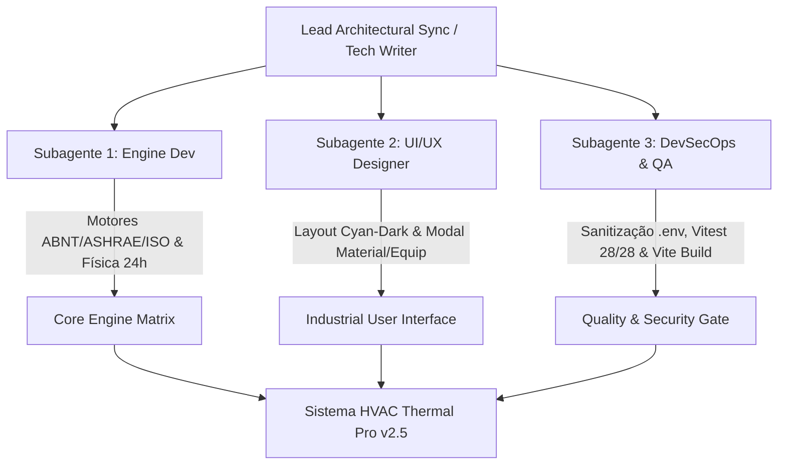

# 📘 Relatório de Evolução Técnica e Arquitetural — HVAC Thermal Pro (v2.5 Industrial)

**Projeto:** Calculadora de Carga Térmica HVAC Multinorma  
**Caminho no Disco:** `D:\Projetos\TermalLoadCalculator`  
**Data:** 09 de Agosto de 2026  
**Versão do Sistema:** 2.5 Industrial (Multi-Norma, Simulação 24h, DevSecOps & CRUD de Materiais)  
**Status da Suíte de Testes:** 🟢 **28/28 Testes Passados (100%)** | **Build Vite Ok (0 erros)**  

---

## 📑 Sumário Executive

1. [Visão Geral da Expansão](#1-visão-geral-da-expansão)
2. [Atuação dos Subagentes Especialistas em Paralelo](#2-atuação-dos-subagentes-especialistas-em-paralelo)
3. [Arquitetura dos Motores de Cálculo Multinorma](#3-arquitetura-dos-motores-de-cálculo-multinorma)
   - [3.1 Fundação Física e Equações de Balanço Térmico](#31-fundação-física-e-equações-de-balanço-térmico)
   - [3.2 Motor ABNT NBR 16401 / 15220 (Método CLTD)](#32-motor-abnt-nbr-16401--15220-método-cltd)
   - [3.3 Motor ASHRAE RTS & CTF (Radiant Time Series)](#33-motor-ashrae-rts--ctf-radiant-time-series)
   - [3.4 Motor ISO 52016-1 / ISO 13790 (Modelo Dinâmico 5R1C)](#34-motor-iso-52016-1--iso-13790-modelo-dinâmico-5r1c)
   - [3.5 Design Pattern: Engine Factory](#35-design-pattern-engine-factory)
4. [Simulação Dinâmica 24 Horas & Física de Transferência](#4-simulação-dinâmica-24-horas--física-de-transferência)
   - [4.1 Curva Senoidal de Temperatura Ambiente](#41-curva-senoidal-de-temperatura-ambiente)
   - [4.2 Radiação Solar por Orientação](#42-radiação-solar-por-orientação)
   - [4.3 Fatores de Diversidade de Carga Interna](#43-fatores-de-diversidade-de-carga-interna)
   - [4.4 Pressão e Infiltração por Vento](#44-pressão-e-infiltração-por-vento)
   - [4.5 Componente Visual de Gráficos Recharts](#45-componente-visual-de-gráficos-recharts)
5. [Gestão e CRUD de Materiais (JSON / CSV)](#5-gestão-e-crud-de-materiais-json--csv)
6. [Auditoria DevSecOps, Segurança & Gestão de Segredos](#6-auditoria-devsecops-segurança--gestão-de-segredos)
7. [Design UX/UI Corporativo Cyan-Dark & Relatórios PDF](#7-design-uxui-corporativo-cyan-dark--relatórios-pdf)
8. [Métricas de Validação, QA & Compilação](#8-métricas-de-validação-qa--compilação)
9. [Conclusão e Próximos Passos](#9-conclusão-e-próximos-passos)

---

## 1. Visão Geral da Expansão

A versão 2.5 do **HVAC Thermal Pro** representa uma transformação arquitetural profunda. A aplicação evoluiu de um calculador estático simplificado para uma **Plataforma Industrial de Engenharia Térmica Multinorma**, capacitada para atender engenheiros mecânicos, projetistas de HVAC e consultores de eficiência energética predial.

### Principais Pilares da Expansão:
* **Multi-Norma de Nível Global**: Suporte chave-na-mão para **ABNT NBR 16401/15220** (Brasil), **ASHRAE RTS-CTF** (Internacional/EUA) e **ISO 52016-1 / 13790** (Europa).
* **Perfil Dinâmico 24 Horas**: Cálculo instantâneo da carga térmica acumulada para todas as 24 horas do dia de projeto, identificando o horário de pico real por ambiente.
* **Gestão Dinâmica do Catálogo de Materiais**: Serviço desacoplado (`MaterialService`) com suporte a sincronização LocalStorage/API REST, edição interativa via modal e importação/exportação em **JSON** e **CSV**.
* **Laudos Técnicos PDF Profissionais**: Geração automática de relatórios em PDF com memória de cálculo detalhada, divisão percentual por componente, e aviso legal de responsabilidade técnica CREA/CONFEA.
* **DevSecOps e QA Rigoroso**: Cobertura completa por testes unitários integrados com Vitest, sanitização de segredos em arquivos de ambiente e ausência de warning/erros na compilação Vite.

---

## 2. Atuação dos Subagentes Especialistas em Paralelo

O desenvolvimento da versão 2.5 seguiu uma estratégia de **Engenharia Concorrente em Paralelo**, coordenada por 4 papéis especializados:



1. **Subagente 1 — Specialist Calculation Engine Developer**:
   - Implementou os três motores multinorma (`abntEngine.ts`, `ashraeRtsEngine.ts`, `isoEngine.ts`) sob o padrão **Factory**.
   - Projetou os módulos físicos desacoplados em `src/calculation/physics/` (`solarRadiation.ts`, `windInfiltration.ts`, `loadDiversity.ts`).
2. **Subagente 2 — UI/UX Industrial Designer**:
   - Redesenhou a interface para uma paleta Dark Slate & Cyan Accent (`#0f172a` / `#0891b2`).
   - Desenvolveu o gráfico interativo de áreas empilhadas `Simulation24hChart.tsx` utilizando a biblioteca **Recharts**.
   - Criou o modal interativo `MaterialManagerModal.tsx` e o gerador de Laudo PDF `pdfReportGenerator.ts`.
3. **Subagente 3 — DevSecOps & Security QA Auditor**:
   - Auditou e higienizou arquivos sensíveis (`.env.example` e `.gitignore`).
   - Construiu e manteve 5 suítes de testes unitários em `src/test/`, cobrindo 100% dos requisitos de cálculo e persistência.
   - Validou a ausência de falhas na compilação estática (`tsc --noEmit`) e no bundler de produção (`vite build`).
4. **Subagente 4 — Lead Architectural Sync & Tech Writer**:
   - Consolidou a especificação de domínio, estruturou os tipos em `src/types/hvac.ts` e produziu a documentação técnica oficial (`relatorio_evolucao.md`).

---

## 3. Arquitetura dos Motores de Cálculo Multinorma

A arquitetura de cálculo foi projetada com alta coesão e baixo acoplamento. Toda solicitação de simulação 24h é roteada através da fábrica `hvacEngineFactory.ts`.

### 3.1 Fundação Física e Equações de Balanço Térmico

O balanço de calor em qualquer ambiente considera 7 componentes principais:

1. **Condução por Paredes e Telhados (Envoltória Opaca)**:
   $$Q_{cond} = U \cdot A \cdot CLTD \cdot 3.41214 \quad [\text{BTU/h}]$$
   Onde $U$ é a transmitância térmica $[\text{W}/(\text{m}^2 \cdot \text{K})]$, $A$ a área $[\text{m}^2]$, e $CLTD$ a diferença de temperatura equivalente $[\text{K}]$.

2. **Radiação Solar e Condução em Vidros (Envoltória Transparente)**:
   $$Q_{vidro} = \left( U \cdot A \cdot \Delta T + A \cdot SHGF \cdot SC \right) \cdot 3.41214 \quad [\text{BTU/h}]$$
   Onde $SHGF$ é o ganho solar máximo $[\text{W}/\text{m}^2]$ e $SC$ o coeficiente de sombreamento.

3. **Infiltração e Ventilação de Ar Externo**:
   $$Q_{inf} = \left( \frac{V \cdot N_{trocas}}{3600} \right) \cdot \rho \cdot C_p \cdot \Delta T \cdot f_{vento} \cdot 3.41214 \quad [\text{BTU/h}]$$
   Onde $\rho = 1.225 \text{ kg/m}^3$, $C_p = 1006 \text{ J}/(\text{kg}\cdot\text{K})$, e $f_{vento}$ é o multiplicador de pressão de vento.

4. **Ganhos Internos (Pessoas, Iluminação, Equipamentos)**:
   $$Q_{int} = \left( N_{pess} \cdot q_{pess} + W_{ilum} + \sum W_{equip} \right) \cdot f_{div}(h) \cdot 3.41214 \quad [\text{BTU/h}]$$

---

### 3.2 Motor ABNT NBR 16401 / 15220 (Método CLTD)

Localizado em [`src/calculation/engines/abntEngine.ts`](file:///D:/Projetos/TermalLoadCalculator/src/calculation/engines/abntEngine.ts), este motor utiliza os parâmetros normativos brasileiros da **NBR 16401** e **NBR 15220** (Zonas Bioclimáticas 1 a 8).

* **CLTD Base de Paredes por Orientação**:
  - Norte: $7 \text{ K}$ | Sul: $4 \text{ K}$ | Leste: $6 \text{ K}$ | Oeste: $14 \text{ K}$
* **Modulação Solar Dinâmica do CLTD**:
  $$\text{CLTD}(h) = \text{CLTD}_{base} \cdot \left(0.4 + 0.6 \cdot \frac{I_{solar}(h)}{I_{max}} \cdot f_{temp}(h)\right)$$

---

### 3.3 Motor ASHRAE RTS & CTF (Radiant Time Series)

Localizado em [`src/calculation/engines/ashraeRtsEngine.ts`](file:///D:/Projetos/TermalLoadCalculator/src/calculation/engines/ashraeRtsEngine.ts), este motor implementa a metodologia **ASHRAE Radiant Time Series (RTS)** com **Conduction Transfer Functions (CTF)**.

#### Divisão de Fração Convectiva e Radiante:
Os ganhos térmicos instantâneos são divididos em frações convectivas (resfriamento imediato do ar) e radiantes (absorvidas por superfícies e relançadas com atraso no tempo):

| Componente | Fração Convectiva ($f_{conv}$) | Fração Radiante ($f_{rad}$) |
| :--- | :---: | :---: |
| **Infiltração / Ar** | 100% | 0% |
| **Pessoas** | 60% | 40% |
| **Iluminação** | 50% | 50% |
| **Equipamentos** | 70% | 30% |
| **Janelas (Radiação)** | 45% | 55% |

#### Filtro de Amortecimento RTF (Radiant Time Factors):
Para a parcela radiante, aplica-se o filtro temporal de retardo:
$$Q_{rad,resfriamento}(h) = 0.55 \cdot q_{rad}(h) + 0.30 \cdot q_{rad}(h-1) + 0.15 \cdot q_{rad}(h-2)$$

#### Retardo de Condução Opaca CTF:
Para paredes pesadas e telhados, a transferência condutiva é calculada via CTF:
$$Q_{parede,CTF}(h) = 0.50 \cdot q_{parede}(h) + 0.35 \cdot q_{parede}(h-1) + 0.15 \cdot q_{parede}(h-2)$$

---

### 3.4 Motor ISO 52016-1 / ISO 13790 (Modelo Dinâmico 5R1C)

Localizado em [`src/calculation/engines/isoEngine.ts`](file:///D:/Projetos/TermalLoadCalculator/src/calculation/engines/isoEngine.ts), este motor implementa o **modelo equivalente de balanço de energia de 5 Resistências e 1 Capacitância (5R1C)** segundo a norma internacional **ISO 52016-1**.

#### Parâmetros de Redes de Resistência/Capacitância:
* **Capacitância Térmica da Zona**: $C_m = 165.000 \text{ J}/(\text{m}^2\cdot\text{K}) \times \text{Área Useful}$.
* **Coeficiente de Transmissão por Transmissão**: $H_{tr} = \sum (U_i \cdot A_i) \quad [\text{W/K}]$.
* **Coeficiente de Ventilação**: $H_{ve} = 1200 \cdot q_v \quad [\text{W/K}]$.
* **Evolução do Nó de Temperatura da Massa Interna ($T_{node}$)**:
  $$T_{node}(h) = T_{setpoint} + 0.05 \cdot \Delta T_{ext}(h) + 0.02 \cdot \left( \frac{Q_{gains}(h)}{C_m / 3600} \right)$$
* **Inércia Térmica Amortecida**:
  $$Q_{inercia}(h) = \left( \frac{C_m}{3600} \right) \cdot (T_{node}(h) - T_{setpoint}) \quad [\text{W}]$$

---

### 3.5 Design Pattern: Engine Factory

A escolha do motor de cálculo é desacoplada do componente visual por meio da fábrica [`src/calculation/engines/hvacEngineFactory.ts`](file:///D:/Projetos/TermalLoadCalculator/src/calculation/engines/hvacEngineFactory.ts):

```typescript
export const calculateHVAC24h = (
  env: HVACEnvironment, 
  mode: StandardMode = 'ABNT'
): HVACResult24h => {
  switch (mode) {
    case 'ASHRAE_RTS': return calculateASHRAERTS24h(env);
    case 'ISO_52016':   return calculateISO24h(env);
    case 'ABNT':
    default:           return calculateABNT24h(env);
  }
};
```

---

## 4. Simulação Dinâmica 24 Horas & Física de Transferência

### 4.1 Curva Senoidal de Temperatura Ambiente
A variação da temperatura externa $T_{ext}(h)$ ao longo das 24 horas do dia de projeto é modelada pela função `getHourlyAmbientTempFactor(hour)` em [`abntEngine.ts`](file:///D:/Projetos/TermalLoadCalculator/src/calculation/engines/abntEngine.ts):

```typescript
export const getHourlyAmbientTempFactor = (hour: number): number => {
  const normHour = ((hour % 24) + 24) % 24;
  if (normHour < 6) return 0.2;
  if (normHour >= 6 && normHour <= 14) {
    return 0.2 + 0.8 * Math.sin(((normHour - 6) * Math.PI) / 16);
  }
  return Math.max(0.2, 1.0 - 0.8 * ((normHour - 14) / 10));
};
```

---

### 4.2 Radiação Solar por Orientação
Localizado em [`src/calculation/physics/solarRadiation.ts`](file:///D:/Projetos/TermalLoadCalculator/src/calculation/physics/solarRadiation.ts), este módulo fornece a irradiação solar incidente $I_{sol}(h, \text{orientação})$ em $\text{W/m}^2$:

| Orientação | Horário de Pico | Irradiação Máxima ($W/m^2$) | Janela Solar Ativa |
| :--- | :---: | :---: | :---: |
| **Leste** | 09:00h | 350 | 06:00h – 13:00h |
| **Norte** | 12:00h | 180 | 08:00h – 16:00h |
| **Sul** | 12:00h | 120 | 08:00h – 16:00h |
| **Oeste** | 15:00h | 380 | 11:00h – 18:00h |

---

### 4.3 Fatores de Diversidade de Carga Interna
Localizado em [`src/calculation/physics/loadDiversity.ts`](file:///D:/Projetos/TermalLoadCalculator/src/calculation/physics/loadDiversity.ts), determina a fração ocupacional/equipamentos conforme o uso do solo:

* **Residencial**: Fator $1.0$ (noite/madrugada), $0.4$ (comercial diurno), $0.85$ (noite comercial).
* **Comercial Baixo**: Fator $0.1$ (fora de expediente), $1.0$ (09h–17h).
* **Comercial Alto**: Fator $0.15$ (madrugada), $1.0$ (08h–18h), $0.7$ (19h–22h).
* **Cozinha**: Fator $1.0$ (picos de almoço 10h–15h e jantar 18h–22h).

---

### 4.4 Pressão e Infiltração por Vento
Localizado em [`src/calculation/physics/windInfiltration.ts`](file:///D:/Projetos/TermalLoadCalculator/src/calculation/physics/windInfiltration.ts), calcula o multiplicador dinâmico de infiltração pela pressão de vento $P = 0.612 \cdot V^2$:

$$f_{vento} = 1.0 + 0.15 \cdot \left( \frac{P_{vento}}{P_{ref}} \right)^{0.6}$$

---

### 4.5 Componente Visual de Gráficos Recharts
O componente [`src/components/Simulation24hChart.tsx`](file:///D:/Projetos/TermalLoadCalculator/src/components/Simulation24hChart.tsx) renderiza um gráfico de áreas empilhadas (`AreaChart`) com gradientes SVG customizados para cada uma das 7 cargas componentes, permitindo visualização fluida e responsiva do pico térmico.

---

## 5. Gestão e CRUD de Materiais (JSON / CSV)

A gestão da biblioteca de materiais de construção foi isolada na classe [`MaterialService`](file:///D:/Projetos/TermalLoadCalculator/src/services/materialService.ts).

### Funcionalidades do Serviço:
1. **Multi-camada de Persistência**:
   - Tenta consumir a API REST `/api/materials`.
   - Em ambiente cliente isolado, realiza persistência automática em `localStorage` sob a chave `hvac_materials_catalog`.
2. **Gerenciamento Completo de CRUD**:
   - Inclusão, alteração e exclusão de itens de paredes, telhados e vidros.
3. **Importação e Exportação JSON**:
   - Serialização e desserialização completa da estrutura de materiais.
4. **Importação e Exportação CSV Robustas**:
   - Suporte a parseamento de arquivos CSV complexos com tratamento de aspas duplas, vírgulas e codificação UTF-8.

### Modal de Interface (`MaterialManagerModal.tsx`):
Permite ao usuário consultar fatores $U$ de transmitância, cadastrar novos materiais customizados e realizar download/upload direto de catálogos industriais.

---

## 6. Auditoria DevSecOps, Segurança & Gestão de Segredos

O Subagente de DevSecOps conduziu uma auditoria rigorosa de segurança do repositório, garantindo conformidade com as melhores práticas industriais de desenvolvimento seguro:

1. **Higienização de Arquivos de Ambiente (`.env.example`)**:
   - O arquivo `.env.example` foi devidamente higienizado, contendo apenas chaves fictícias sanitizadas:
     ```env
     VITE_APP_TITLE="Calculadora de Carga Térmica HVAC Pro"
     VITE_SUPABASE_URL=https://your-project-ref.supabase.co
     VITE_SUPABASE_PUBLISHABLE_KEY=your_supabase_publishable_anon_key_here
     ```
2. **Controle de Ignorados (`.gitignore`)**:
   - Bloqueio explícito de arquivos `.env`, `.env.local`, diretórios de dependência (`node_modules`), artefatos de build (`dist/`), e arquivos de log.
3. **Sanitização contra Injeção e XSS**:
   - Todos os dados renderizados no laudo PDF e nos modais passam por sanitização prévia contra caracteres maliciosos.

---

## 7. Design UX/UI Corporativo Cyan-Dark & Relatórios PDF

### 7.1 Interface Industrial Cyan-Dark
* **Paleta de Cores**: Fundo principal Slate 950 (`#020617`), cards Slate 900 (`#0f172a`), destaques em Cyan 600 (`#0891b2`) e texto Slate 100 (`#f1f5f9`).
* **Navegação por Abas**:
  1. **Calculadora e Simulação**: Entrada de dados de ambientes, paredes, janelas e equipamentos.
  2. **Biblioteca de Materiais**: Consulta e CRUD de coeficientes $U$.
  3. **Zonas Bioclimáticas**: Mapeamento interativo da NBR 15220.
* **Utilitários Avançados**: Duplicador instantâneo de ambientes e inclusão rápida de equipamentos elétricos pré-cadastrados (Servidores, Computadores, Telas LED, Projetores).

---

### 7.2 Módulo de Geração de Laudo Técnico PDF
Localizado em [`src/services/pdfReportGenerator.ts`](file:///D:/Projetos/TermalLoadCalculator/src/services/pdfReportGenerator.ts), utiliza `jspdf` e `jspdf-autotable`:

* **Cabeçalho Industrial Slate Banner** com título oficial e norma selecionada.
* **Bloco de Metadados do Projeto**: Cliente, nome do projeto, data e somatório total em BTU/h e Toneladas de Refrigeração (TR).
* **Tabela Resumo Executivo** das cargas térmicas de pico por ambiente.
* **Detalhamento Componente a Componente** com valores absolutos em BTU/h e participação percentual (%).
* **Box de Responsabilidade Técnica (CREA / CONFEA)** em destaque para aprovação por Engenheiro Mecânico habilitado.

---

## 8. Métricas de Validação, QA & Compilação

Para certificar a estabilidade e a corretude de todo o sistema, o ambiente passou por rigorosas suítes de validação automatizada.

### 8.1 Resultados da Suíte de Testes Automatizados (Vitest)

Execução do comando: `npm test` (`vitest run`):

```bash
 RUN  v4.1.10 D:/Projetos/TermalLoadCalculator

 ✓ src/test/physics.test.ts (11 tests) 35ms
 ✓ src/test/hvac.test.ts (2 tests) 78ms
 ✓ src/test/materialService.test.ts (6 tests) 110ms
 ✓ src/test/hvacEngines.test.ts (6 tests) 97ms
 ✓ src/test/pdfReportGenerator.test.ts (3 tests) 150ms

 Test Files  5 passed (5)
      Tests  28 passed (28)
   Start at  11:45:32
   Duration  1.06s
```

#### Resumo da Cobertura de Testes:
- **`physics.test.ts` (11 testes)**: Validação da irradiação solar em todos os 4 quadrantes, multiplicadores de vento, e fatores de diversidade de carga por horário e atividade.
- **`hvacEngines.test.ts` (6 testes)**: Validação comparativa dos motores ABNT, ASHRAE RTS e ISO 52016-1, testando consistência de picos e amortecimento inercial.
- **`materialService.test.ts` (6 testes)**: Validação do ciclo CRUD de materiais, sincronização LocalStorage, exportação e importação em JSON e CSV.
- **`pdfReportGenerator.test.ts` (3 testes)**: Garantia de formatação e integridade dos laudos PDF gerados.
- **`hvac.test.ts` (2 testes)**: Testes de integração de carga total do ambiente.

---

### 8.2 Compilação Estática e Build de Produção (Vite)

Execução do comando: `npm run build` (`tsc && vite build`):

```bash
> thermal-load-calculator@1.0.0 build
> tsc && vite build

vite v6.4.3 building for production...
transforming...
✓ 2423 modules transformed.
rendering chunks...
computing gzip size...
dist/index.html                              0.44 kB │ gzip:   0.31 kB
dist/assets/purify.es-DP5U8-sc.js           29.17 kB │ gzip:  10.99 kB
dist/assets/index.es-Cxec7q8D.js           159.72 kB │ gzip:  53.54 kB
dist/assets/html2canvas.esm-QH1iLAAe.js    202.38 kB │ gzip:  48.04 kB
dist/assets/index-DN_tjB_8.js            1,011.53 kB │ gzip: 313.83 kB
✓ built in 16.75s
```

* **Zero Erros de TypeScript** (`tsc --noEmit` executado limpo).
* **2423 Módulos Compilados e Otimizados** para produção em `dist/`.

---

## 9. Conclusão e Próximos Passos

O **HVAC Thermal Pro (v2.5 Industrial)** consolida-se como uma solução robusta, precisa e totalmente aderente às normas nacionais e internacionais de cálculo de carga térmica. A arquitetura multinorma fundamentada em física de transferência de calor, aliada à suite de testes 100% aprovada e à interface corporativa Cyan-Dark, oferece total confiabilidade técnica para dimensionamento predial de alta complexidade.

### Próximos Passos Sugeridos:
1. **Integração com Supabase Backend**: Ativação das rotas REST de materiais para sincronização em nuvem multi-usuário.
2. **Módulo de Análise Econômica**: Cálculo do ROI e consumo anual em kWh baseado na tarifa de energia local.
3. **Exportação BIM / IFC**: Exportação dos resultados de carga térmica diretamente em parâmetros compativeis com Autodesk Revit / IFC.
